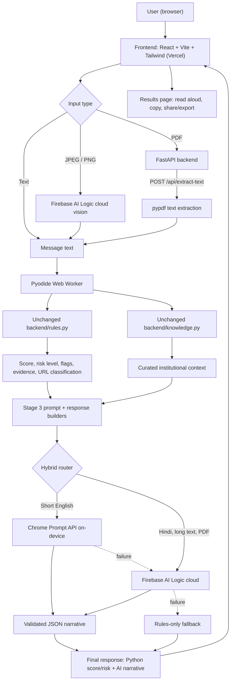
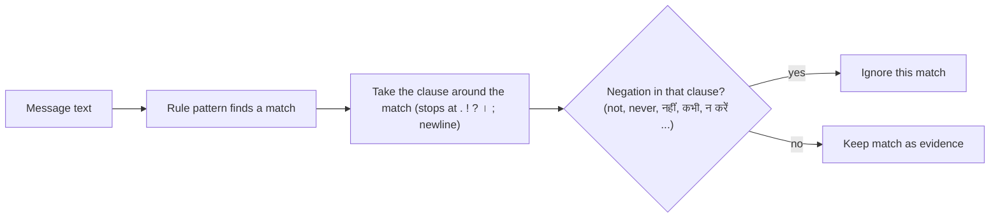

# RedFlagged Hybrid: Technical Design Document

## 1. Purpose

RedFlagged Hybrid helps people spot warning signs in suspicious messages (SMS, WhatsApp, email, PDFs, screenshots) that imitate banks, government departments, couriers, employers, or payment services. It supports English and Hindi.

Design goals:

1. **Transparent scoring.** The risk score comes from deterministic Python rules that can be inspected, not from an AI's opinion.
2. **Useful explanations.** AI explains the findings in plain language while the Python rules remain authoritative.
3. **Never fail silently.** If AI is unavailable, the user still receives a rule-based score, risk level, evidence, and safety steps.
4. **Safe by default.** The app gives verification guidance and never claims a message is legally genuine or fake.
5. **Hybrid by design.** Short English text can run on-device; other cases use cloud inference. The UI reports the actual inference source.

Non-goals: legal advice, proving that a document is authentic, or detecting every possible scam.

## 2. System architecture



## 3. Request flow

```mermaid
sequenceDiagram
    participant User
    participant Frontend
    participant Worker as Pyodide Worker
    participant Firebase as Firebase AI Logic
    participant Backend as FastAPI

    User->>Frontend: Paste text or upload file
    alt JPEG / PNG
        Frontend->>Firebase: Cloud image text extraction
        Firebase-->>Frontend: Extracted text
    else PDF
        Frontend->>Backend: POST /api/extract-text
        Backend-->>Frontend: pypdf extracted text
    end

    Frontend->>Worker: analyze_rules(text)
    Worker-->>Frontend: rule score, level, flags, evidence, language
    Frontend->>Frontend: Retrieve knowledge and build prompt
    Frontend->>Frontend: Choose requested path

    alt Device eligible and available
        Frontend->>Firebase: initializeDeviceModel + generateContent
        Firebase-->>Frontend: Narrative JSON + inferenceSource
        Note over Frontend: Device failure -> one cloud attempt
    else Cloud path
        Frontend->>Firebase: Cloud generateContent
        Firebase-->>Frontend: Narrative JSON + inferenceSource
    end

    Frontend->>Frontend: Validate AI JSON; merge with Python rule result
    Frontend-->>User: Existing results UI with actual-path badge
```

## 4. Components

| Component | File | Responsibility |
|---|---|---|
| UI | `frontend/src/App.jsx` | Input, file upload, results rendering, speech, share/export, status/badge display |
| Hybrid router | `frontend/src/hybridAnalyze.js` | Path eligibility, device availability, one cloud fallback, rules-only fallback, actual-path metadata |
| Analysis layer | `frontend/src/analysis/` | Prompt, knowledge, response builder, schemas, Firebase inference service, image extraction |
| Pyodide bridge | `frontend/src/pyodide/` | Web Worker, unchanged Python sources, JSON dispatch, loading/progress states |
| Upload processing | `frontend/src/uploadPipeline.js` | PDF vs image vs unsupported classification; backend/Firebase extraction |
| Status mapping | `frontend/src/inferenceStatus.js` | Badge labels and loading/progress messages |
| Backend | `backend/main.py` | PDF extraction, CORS, legacy `/api/analyze` and image extraction, optional Gemini |
| Rule engine | `backend/rules.py` | Deterministic detection, scoring, language detection, Hindi/English explanations |
| Knowledge | `backend/knowledge.py` | Curated institutional guidance matched to the message |
| Regression tests | `backend/t.py`, `frontend/test/` | 30 Python sample messages and frontend unit/integration tests |

## 5. Rule engine design

The Python rule engine remains unchanged and authoritative. In the browser it runs through Pyodide 0.27.8 (CPython 3.12.7) inside a Web Worker.

### 5.1 Rules and weights

| Rule | Points | What it looks for |
|---|---|---|
| Urgent deadline or coercion | 35 | Arrest, warrant, freeze, block, "within 2 hours", "तुरंत", "turant", and similar |
| Financial demand or digital payment | 35 | Pay/deposit/transfer words near an amount (₹, Rs, INR), UPI handles |
| Suspicious external link | 25 to 40 (highest finding) | Raw IP (35), link shortener (25), abuse-prone TLD (25), brand in an unrelated domain (40), lookalike domain by edit distance (35) |
| OTP, Aadhaar or credential request | 35 | OTP, PIN, password, Aadhaar, KYC and Hindi equivalents |
| Courier or customs hold scam | 30 | Customs or clearance fee, held parcel |
| Job or recruitment scam lure | 30 | Fees for jobs or internships, work-from-home offers, prize lures, Hindi equivalents |

### 5.2 Score and risk level

Triggered rules add up to raw points. A saturating curve turns them into a 0 to 100 score:

```text
score = round(100 * (1 - exp(-raw_points / 38)))
```

| Raw points | Score | Level |
|---|---|---|
| 0 | 0 | LOW |
| 35 (one rule) | 60 | MEDIUM |
| 65 to 70 (two rules) | 82 to 84 | HIGH |
| 105 (three rules) | 94 | HIGH |

Thresholds: below 25 is LOW, 25 to 64 is MEDIUM, 65 and above is HIGH. The level is derived from the score, so the two always agree. AI does not change either value.

### 5.3 Matching and negation



Design decisions:

- **Hindi-safe word boundaries.** Python's `\b` does not treat Devanagari vowel signs as word characters, so patterns use explicit look-arounds instead. Without this, many Hindi rules would silently never match.
- **One negation check, limited to the same clause.** "Never share your OTP" and "बैंक कभी भी OTP नहीं मांगता" stay LOW, while a "do not" in a different sentence cannot cancel a real payment demand.
- **Generic words are not rules by themselves.** Words such as "अभी", "आज ही" or "साझा" only count when attached to an action (pay, send, share OTP), to avoid flagging everyday chat.

### 5.4 Language handling

`detect_language()` returns `hi` when more than 20 percent of the letters are Devanagari, otherwise `en`. The result drives:

- the language of rule explanations and flags (`rule_hi` holds the Hindi rule name),
- the language instruction sent to the AI prompt,
- the language of the rules-only fallback text.

Roman-script Hindi (Hinglish) is detected by the rules but is treated as English for output. Hindi/Devanagari output is not supported by the on-device model, so it is routed to cloud inference.

## 6. Hybrid AI analysis

### 6.1 Prompt and response schema

The frontend analysis layer is a JavaScript port of the original backend prompt/response helpers:

- `buildPrompt()` mirrors the deterministic prompt builder.
- `retrieveContext()` mirrors the curated knowledge retrieval.
- `linkAssessment()` and `ruleRows()` preserve URL classification and rule evidence.
- `fallbackResponse()` builds the rules-only response.
- The AI response schema is restricted to documented structured-output fields.

The final response always takes `risk_level`, `calculated_score`, `rule_breakdown`, rule evidence, URL classification, and extracted arrays from the Python rule result. AI supplies only narrative fields: `situation_type`, `summary`, `red_flags`, `safe_next_steps`, `verification_guidance`, and `disclaimer`.

### 6.2 Routing

| Condition | Requested path |
|---|---|
| PDF-derived text | Cloud |
| Detected language is not `en` | Cloud |
| Message longer than 8,000 characters | Cloud |
| Estimated prompt + schema above the on-device budget | Cloud |
| Short English text within budget | On-device first |

The on-device budget is derived conservatively from the Chrome Prompt API limit of 9,216 tokens:

- 2,500 tokens reserved for output,
- 15% safety factor,
- input budget `5,708` tokens,
- conservative estimator `ceil(code points / 3)`.

The full prompt and response schema are included in the estimate. If the device path fails or is unavailable, one cloud attempt is made. If both AI paths fail, the rules-only fallback is returned.

### 6.3 On-device and cloud configuration

- On-device uses `InferenceMode.ONLY_ON_DEVICE`, Chrome Prompt API availability, English input/output options, and `onDeviceParams.promptOptions.responseConstraint`.
- Cloud uses `InferenceMode.ONLY_IN_CLOUD`, the `gemini-3.5-flash-lite` model, and `inCloudParams.generationConfig.responseSchema`.
- Device initialization runs from the Analyze click and reports download progress.
- The actual source is read from `result.response.inferenceSource` (`on_device` or `in_cloud`). The UI badge uses that value, never the requested path.

### 6.4 Fallback

- Device failure/unavailability → one cloud attempt.
- Cloud failure or invalid AI JSON → rules-only response.
- Rules-only response includes the Python score, risk level, triggered rules, evidence, fixed safety steps, verification guidance, and disclaimer.

## 7. Image and PDF processing

### Images

JPEG and PNG uploads are sent to Firebase AI Logic cloud inference for verbatim text extraction. The image binary never enters Pyodide. The extracted text then follows normal hybrid routing.

### PDFs

PDFs are sent to FastAPI `/api/extract-text`, which uses `pypdf`. The PDF binary never goes to Firebase AI Logic. The extracted text enters hybrid analysis with `sourceType: "pdf"`, forcing cloud inference.

### Backend image branch

The legacy backend image branch still uses Gemini when `GEMINI_API_KEY` is configured. Without a key it returns HTTP 503. The hybrid frontend does not use this branch.

## 8. API contract

### `POST /api/extract-text`

Form fields: `file` (PDF/image) or `raw_text`. Returns `{"text": "..."}`.

- PDF: `pypdf`, no Gemini required.
- Image: Gemini vision if configured; HTTP 503 otherwise.
- Raw text: returned as-is.

### `POST /api/analyze` (legacy)

Form field: `text`. Returns the `NoticeAnalysisResponse` shape.

- Requires Gemini; returns HTTP 503 without `GEMINI_API_KEY`.
- When Gemini is configured, the original Gemini analysis behavior and rules-only fallback remain.
- The hybrid frontend does not call this route.

### Final frontend response

| Field | Source |
|---|---|
| `situation_type` | AI narrative or fallback text |
| `risk_level` | **Python rule engine** |
| `calculated_score` | **Python rule engine** |
| `rule_breakdown` | **Python rule engine** (including evidence and URL classification) |
| `summary` | AI narrative or fallback text |
| `red_flags` | AI narrative or fallback |
| `safe_next_steps` | AI narrative or fallback |
| `verification_guidance` | AI narrative or fallback |
| `disclaimer` | AI narrative or fallback |
| `amounts`, `payment_handles`, `urgency_phrases`, `extracted_urls` | **Python rule engine** |

## 9. Deployment and configuration

| Part | Platform | Configuration |
|---|---|---|
| Frontend | Vercel | Vite build; Firebase and App Check `VITE_*` variables; `VITE_API_URL` for PDFs |
| Backend | Render or another FastAPI host | `GEMINI_API_KEY` optional for legacy routes; `GEMINI_MODEL` optional |

CORS allows:

```text
https://red-flagged-hybrid.vercel.app
http://localhost:5173
http://127.0.0.1:5173
```

No wildcard origin is used. Secrets stay in environment variables or untracked `.env` files; `.env.example` documents names only.

## 10. Security and privacy

- On-device inference keeps eligible text on the user's device.
- Cloud inference, image extraction, and App Check requests go through Firebase AI Logic.
- PDFs go to the FastAPI backend for extraction.
- The frontend App Check uses reCAPTCHA Enterprise in production; the debug token is dev-only.
- The backend Gemini key is optional and server-side; it is never exposed to the browser.
- The app does not follow or open links found in messages; it analyses their structure.
- Results include a disclaimer and verification advice that points users to independently found official channels.
- The application does not store submitted messages.

## 11. Limitations and trade-offs

- Rules only detect patterns that have been written; unfamiliar scam wording can score LOW.
- Regular-expression rules can misfire on unusual phrasing.
- On-device inference requires supported Chrome desktop and Gemini Nano availability; model download can be slow.
- The on-device token check is a conservative estimate, not exact tokenization.
- Hindi/Devanagari text is routed to cloud inference.
- AI narrative can be incomplete or incorrect; invalid output falls back to cloud or rules-only.
- Cloud inference and image extraction depend on Firebase AI Logic, App Check, network access, and quotas.
- Pyodide is loaded from a CDN and first use can take several seconds.
- The legacy backend `/api/analyze` and image branch still require Gemini when used.
- PDF extraction depends on the FastAPI backend and `pypdf`.
- Reading aloud depends on browser-installed voices.
- Hinglish explanations are produced in English; Gujarati is not supported.
- Production App Check domain allowlisting, Vercel environment variables, backend URL, and CORS still require deployment verification.

## 12. Testing

Frontend:

```bash
cd frontend
npm test
npm run check:rules-parity
npm run lint
npm run build
```

Current automated results:

- `npm test`: 65/65 passed
- Rule parity: 30/30 score/level/flags, full result parity, expected-level checks, knowledge retrieval parity
- Lint passes with existing `App.jsx` warnings
- Production build passes

Backend rule regression:

```bash
cd backend
python -B t.py
```

The 30-message script currently reports `failures: 0`.

The backend pytest files require `pytest`; it is not installed in the current environment, so those tests could not be run without installing dependencies.

Manual verification still required:

- Real Chrome on-device inference and model download
- Real Firebase cloud inference with production App Check
- Real JPEG/PNG extraction
- Real PDF extraction through the deployed backend and CORS
- Device-unavailable cloud fallback
- Rules-only fallback with network/cloud failure
